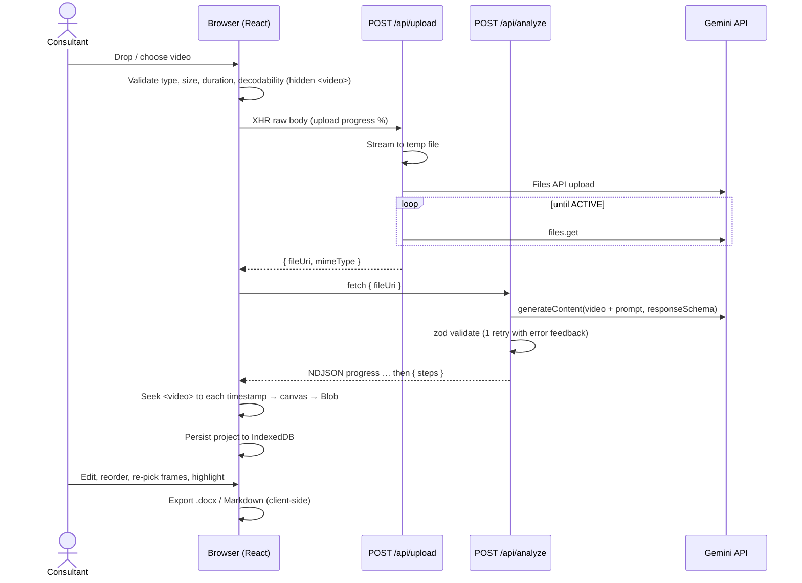

# Architecture

## End-to-end flow



The server is a thin, stateless adapter around Gemini. It holds the API key and does nothing else.
Everything the user produces (steps, screenshots, highlights) lives in the browser. See [D3](DECISIONS.md#d3-screenshots-are-captured-in-the-browser-not-on-the-server) and [D8](DECISIONS.md#d8-local-persistence-in-indexeddb-with-debounced-autosave).

## Module map (planned)

```
src/
  app/
    page.tsx                 # composition only: header, dropzone | progress | editor
    error.tsx                # error boundary
    api/
      upload/route.ts        # stream body → temp file → Gemini Files API → poll ACTIVE
      analyze/route.ts       # generateContent + zod validate, NDJSON stream
  server/
    gemini.ts                # SDK client, upload/poll/generate, error classification
    prompt.ts                # the prompt + response schema
  lib/
    schema.ts                # zod schemas shared by server and client
    timestamp.ts             # parseTimestamp / formatTimestamp (pure, tested)
    geometry.ts              # box_2d (0–1000) ↔ normalized rect (pure, tested)
    errors.ts                # AppError kinds → message + action (D10)
    job-machine.ts           # job phase reducer (D7)
    steps-reducer.ts         # steps reducer (D7)
    frames.ts                # seek-and-capture from a <video> (D3)
    persistence.ts           # IndexedDB load/save, debounced (D8)
    export-docx.ts           # docx builder (D11)
    export-markdown.ts
    transport.ts             # XHR upload with progress, NDJSON reader, AbortController
  components/
    upload/Dropzone.tsx
    upload/JobProgress.tsx   # stage list + live region + cancel
    steps/StepList.tsx       # dnd-kit sortable
    steps/StepCard.tsx       # inline fields, timestamp button, actions
    frames/FramePicker.tsx   # dialog with scrubber (feature 2)
    highlight/HighlightEditor.tsx  # SVG overlay, pointer + keyboard (feature 4)
    export/ExportMenu.tsx
    ui/…                     # shadcn components
```

**Rule of thumb:** anything in `lib/` is framework-free and unit-testable. Components connect it to React.

## Data model

```ts
type Project = {
  id: string;
  title: string;                 // from Gemini processTitle, editable
  video: { blob: Blob; name: string; durationSec: number; width: number; height: number };
  gemini?: { fileUri: string; mimeType: string; expiresAt: string };
  steps: Step[];
  updatedAt: string;
};

type Step = {
  id: string;                    // stable id for React keys & dnd-kit
  action: string;
  description: string;
  expectedResult: string;
  timestampSec: number;          // source of truth for the frame
  screenshot?: Blob;             // captured at timestampSec, original pixels
  highlights: Rect[];            // normalized 0–1, composited only on export
};

type Rect = { x: number; y: number; w: number; h: number };
```
