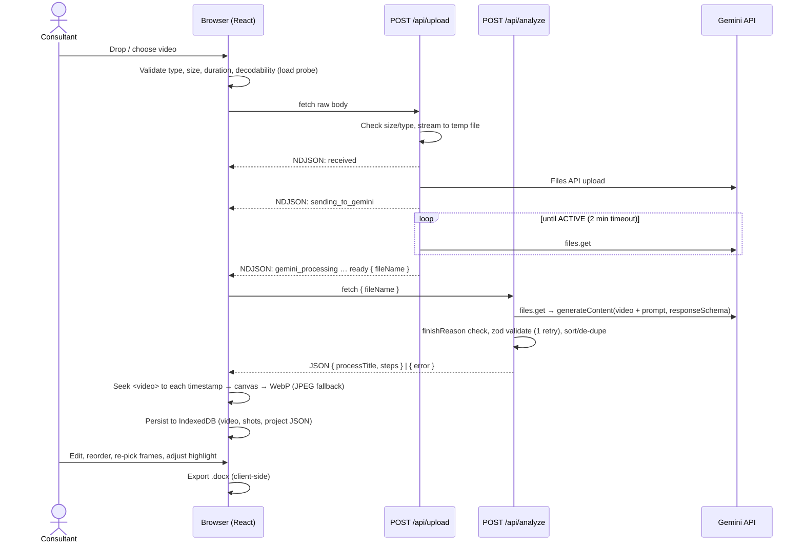

# Architecture

> The exact contracts (types, function signatures, HTTP status behaviour, file ownership) live in [IMPLEMENTATION.md](IMPLEMENTATION.md) and win over this overview.

## End-to-end flow



The server is a thin, stateless adapter around Gemini. It holds the API key and enforces limits, and does nothing else.
Everything the user produces (steps, screenshots, highlights) lives in the browser. See [D3](DECISIONS.md#d3-screenshots-are-captured-in-the-browser-not-on-the-server) and [D8](DECISIONS.md#d8-local-persistence-in-indexeddb-with-debounced-autosave).

## Module map (planned)

```
src/
  app/
    page.tsx                 # composition only: header, dropzone | progress | editor
    error.tsx                # error boundary
    api/
      upload/route.ts        # limits → temp file → Files API → poll ACTIVE, NDJSON stages
      analyze/route.ts       # files.get → generateContent → validate → JSON
      file/route.ts          # DELETE ?name= (Start new)
  server/
    gemini.ts                # SDK client, upload/poll/generate/delete, error classification
    prompt.ts                # the prompt + response schema
  lib/
    schema.ts                # zod schemas shared by server and client
    timestamp.ts             # parseTimestamp / formatTimestamp (pure, tested)
    geometry.ts              # box_2d (0–1000) ↔ normalized rect (pure, tested)
    normalize.ts             # sort + de-dupe steps (pure, tested)
    errors.ts                # AppError kinds → message + action (D10)
    job-machine.ts           # job phase reducer (D7, tested)
    steps-reducer.ts         # steps reducer (D7, tested)
    frames.ts                # load probe + seek-and-capture with timeouts (D3)
    persistence.ts           # IndexedDB keys + debounced project save (D8)
    export-docx.ts           # docx builder; renders an export template's visible columns (D11, D17)
    export-template.ts       # template model, pure helpers, localStorage presets (D17)
    limits.ts                # size/length limits, MIME inference for type-less files (D16, D10)
    normalize.ts             # server-side step normalization + cleanText (D5)
    api-client.ts            # uploadVideo / analyzeVideo / deleteGeminiFile, NDJSON reader
  components/
    upload/Dropzone.tsx
    shell/AppShell.tsx       # app-wide providers, incl. the single aria-live region (useAnnounce, D13)
    shell/AppHeader.tsx      # sticky header with title / actions slots, save status
    upload/JobProgress.tsx   # stage list + elapsed time + cancel (silent; the hook announces)
    editor/StepList.tsx
    editor/StepCard.tsx      # inline fields, move/delete buttons, frame button
    frames/FramePicker.tsx   # dialog with scrubber (feature 2)
    highlight/HighlightEditor.tsx  # SVG overlay, pointer + keyboard (feature 4)
    project/ExportButton.tsx # Export to Word, busy state, non-live failure message
    project/ExportOptions.tsx # Export options dialog: columns, blank columns, presets (D17)
    feedback/ErrorPanel.tsx, ConfirmDialog.tsx, Banner.tsx
    ui/…                     # shadcn components
```

**Rule of thumb:** anything in `lib/` is framework-free and unit-testable. Components connect it to React.

## API contracts

```ts
// POST /api/upload   body: raw video bytes, Content-Type: video/*
// response: application/x-ndjson, one event per line
type UploadEvent =
  | { type: "stage"; stage: "received" | "sending_to_gemini" | "gemini_processing" }
  | { type: "ready"; fileName: string; mimeType: string }
  | { type: "error"; error: SerializedAppError };

// POST /api/analyze  body: { fileName: string }
type AnalyzeResponse =
  | { ok: true; processTitle: string; steps: RawStep[] }  // sorted, validated
  | { ok: false; error: SerializedAppError };

type SerializedAppError = { kind: ErrorKind; detail?: string }; // copy lives in ERROR_COPY
```

## Data model (client)

```ts
// IndexedDB key "project" (JSON only, debounced save)
type Project = {
  id: string;
  title: string;                 // from Gemini processTitle, editable
  video: { name: string; sizeBytes: number; mimeType: string; durationSec: number; width: number; height: number };
  gemini?: { fileName: string; mimeType: string; uploadedAt: string }; // expires after 48 h
  steps: Step[];
  updatedAt: string;
};

type Step = {
  id: string;                    // stable id for React keys and the shot:<id> key
  action: string;
  description: string;
  expectedResult: string;
  timestampSec: number;          // source of truth for the frame
  captureState: "pending" | "ok" | "failed";
  highlight: Rect | null;        // normalized 0–1, composited only on export
  highlightSource: "gemini" | "user" | null;
  suggestedHighlight: Rect | null; // Gemini's original box, for "Reset to suggestion"
};

type Rect = { x: number; y: number; w: number; h: number };

// IndexedDB key "video"         → Blob (written once)
// IndexedDB key "shot:<stepId>" → WebP (or JPEG fallback) Blob (written on capture / re-pick)
```
