# Screenshots

Every state below was captured from the production build with Playwright. The video is our own synthetic 23-second clip of a fictional "Acme Purchasing" form ([`e2e/fixtures/tiny.webm`](../e2e/fixtures/tiny.webm)), so none of the provided sample footage is in the repo.

- **Editor states (3, 5–9)** come from **one real Gemini analysis** (`gemini-3.8-flash`) of that clip: 5 steps found in 16 s. The steps and the suggested highlights are the model's real output.
- **Other states** use fake Gemini mode (`GEMINI_FAKE=1`), which is how the error paths are reached on demand.

## Core flow

### 1. Empty state
Upload area with formats and limits, "how it works", and the privacy line.
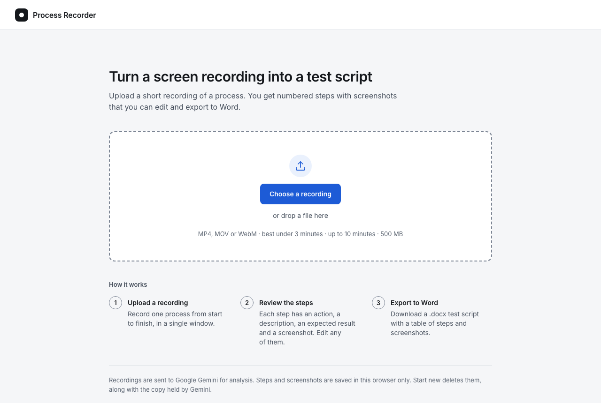

### 2. Processing
Honest progress: the stage list with elapsed time on the current stage, no fake percentage (D4). Cancel is always available.
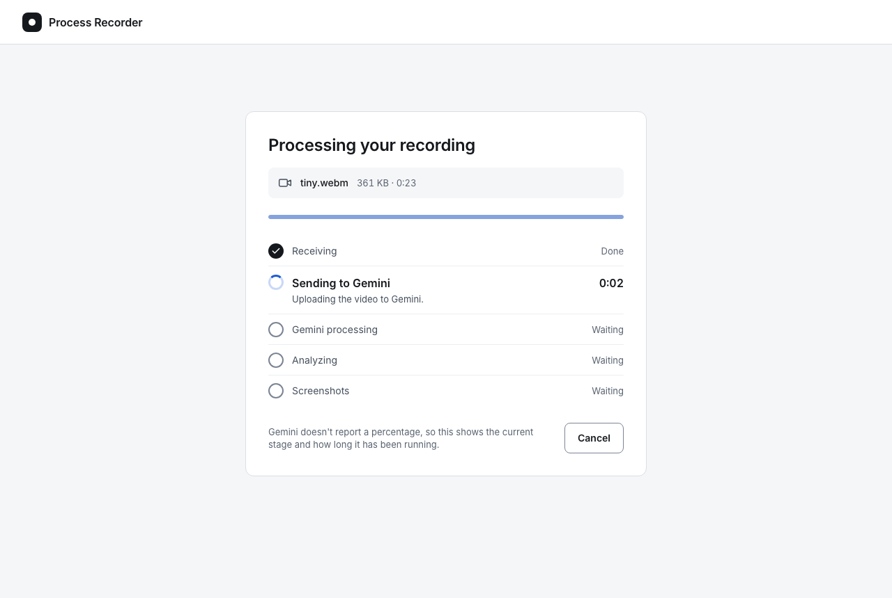

### 3. Editor
5 steps from real Gemini, each with an action, description, expected result, a screenshot captured in the browser (D3), and a **suggested highlight** on the field acted on (D9). The results heading has focus because focus moves there when capture finishes (D13). The header is sticky, showing save status, Start new, Export options and Export to Word.
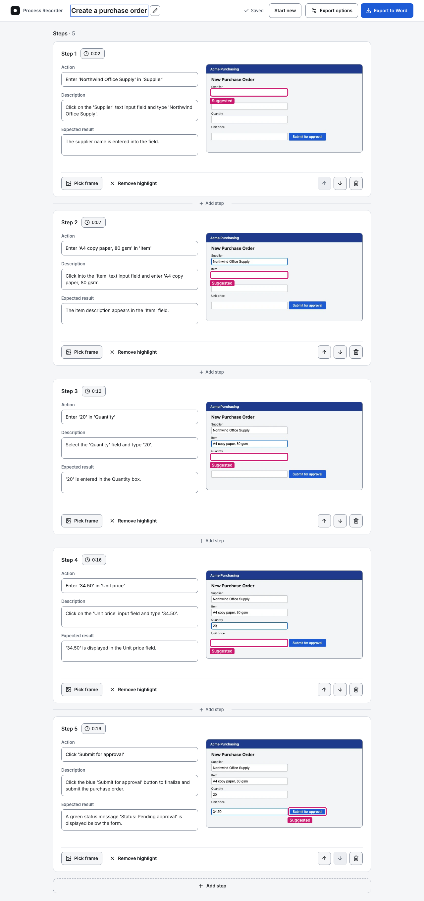

### 4. Long-video notice
Recordings between 3 and 10 minutes are accepted with an info notice (D16). This clip is a synthetic 5:00 test pattern.
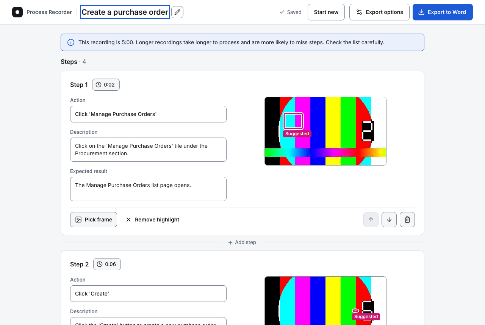

### 5. Frame picker
Re-pick a step's screenshot from another moment. The slider marks the original timestamp, ±0.1 s and ±1 s buttons step precisely, and the keyboard hints say ← → / Shift / Enter / Esc. The step's action shows under the title.
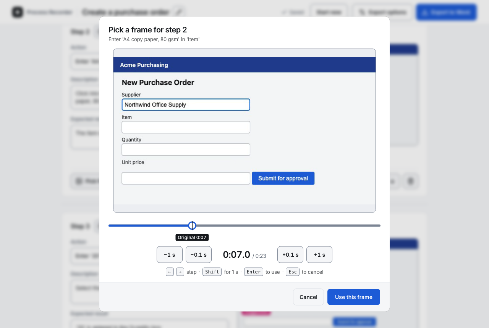

### 6. Highlight editing (in the card)
4 corner handles; arrow keys move, Alt+arrows resize, Delete removes. The keyboard hint appears while the highlight is focused.
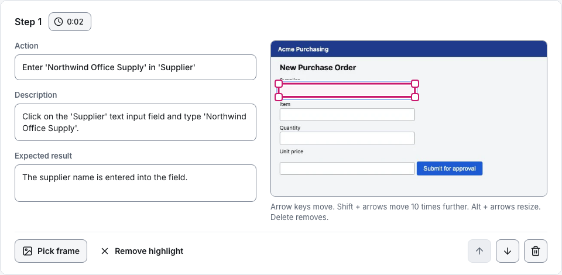

### 7. Inline Undo
Deleting a step leaves an inline "Step 2 deleted · Undo · Dismiss" row where the card was, with focus on Undo and no timeout (D12).
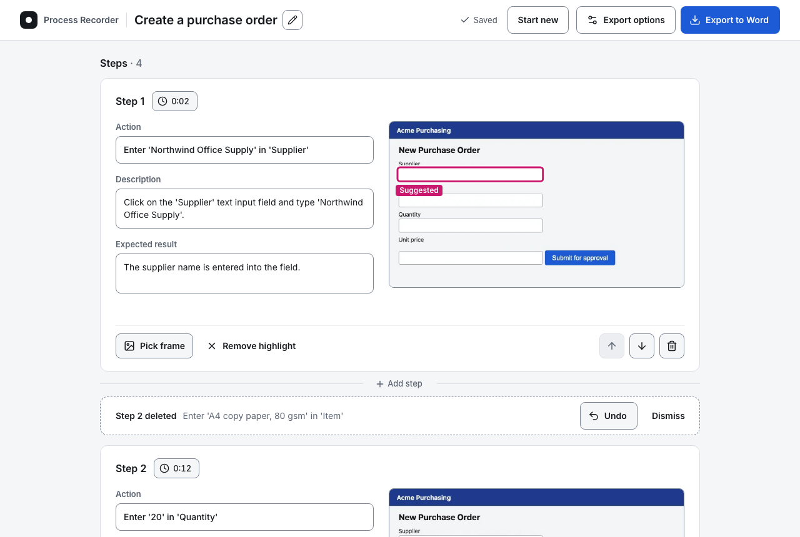

### 8. Export options (templates)
Hide a column, rename a header ("Expected outcome"), and add a blank **Pass/Fail** column for testers. Presets can be saved per client (D17).
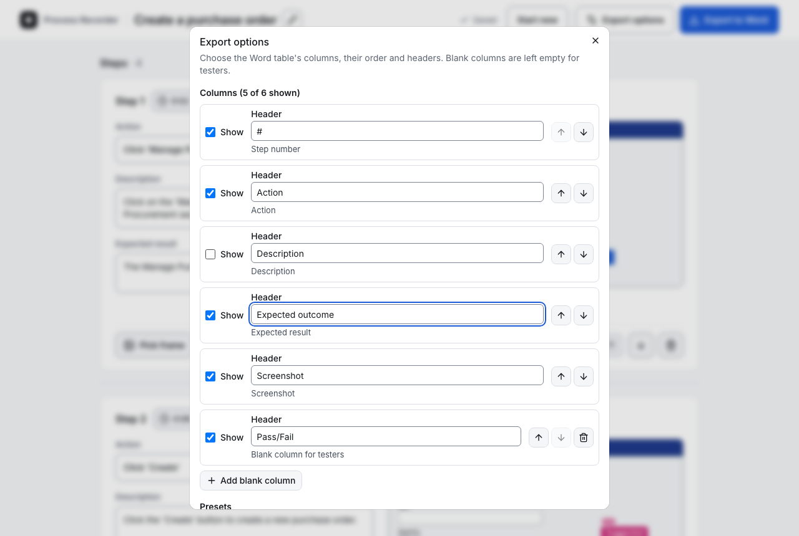

### 9. Start new confirmation
Names what will be deleted, and offers exporting first.
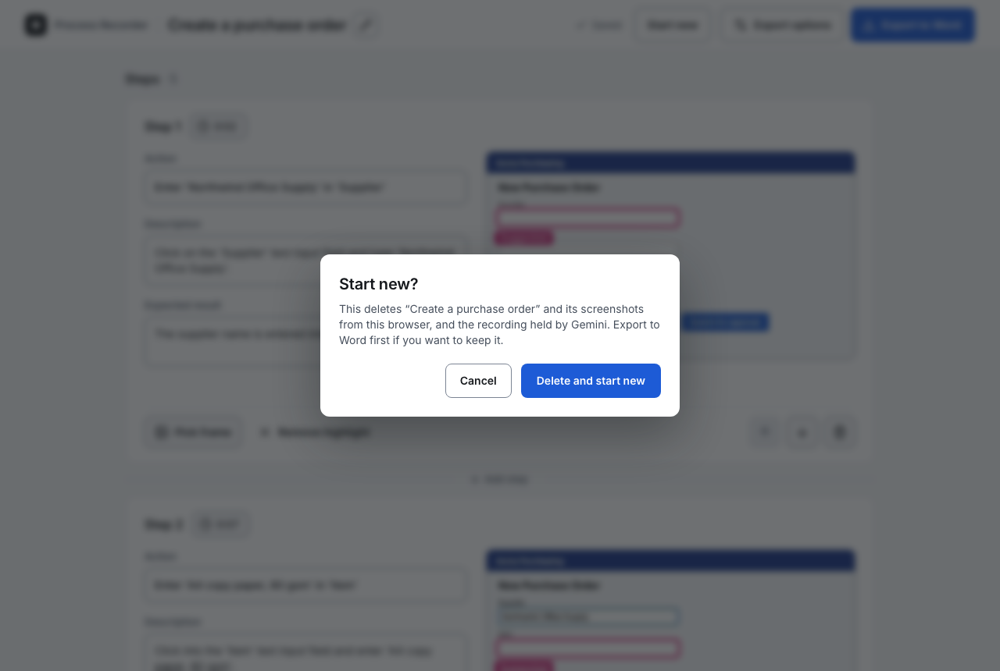

## Errors and edge states

Each error has a cause, what to do, and a primary action (D10). The heading receives focus so screen readers announce it once.

### 10. Not a video
Rejected in the browser before any upload.
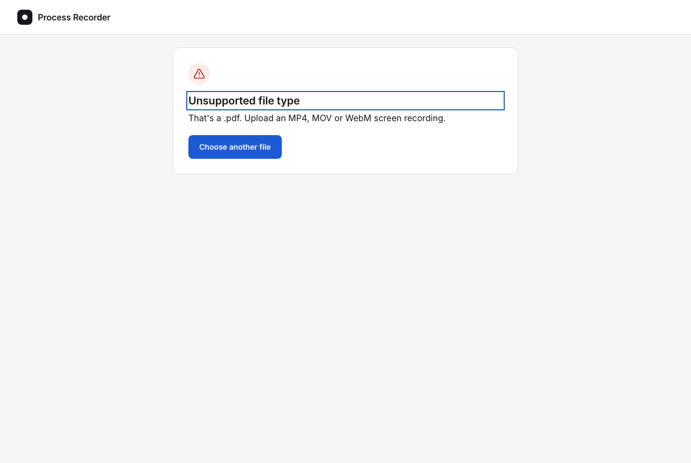

### 11. Too long
Over 10:00 is rejected before any upload, and the message names the length.
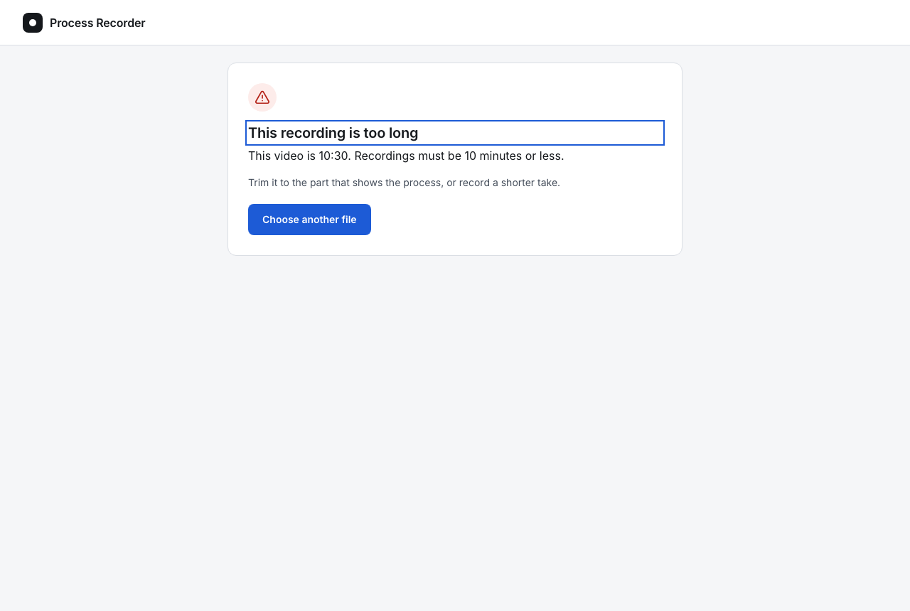

### 12. Rate limited
Retry re-runs analysis **without re-uploading**; the note says so.
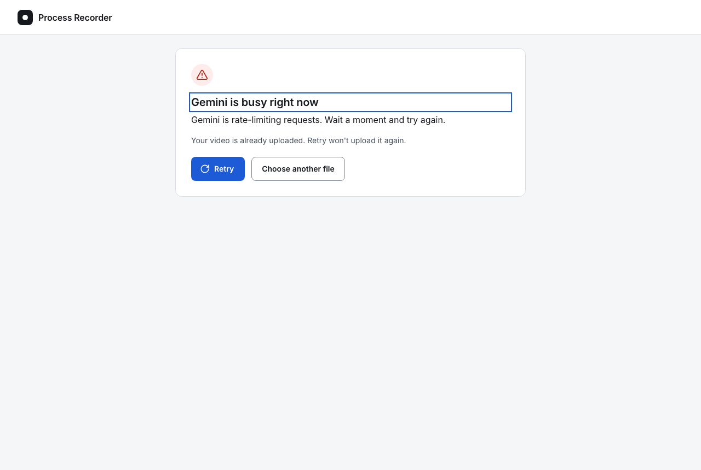

### 13. Not a screen recording
Shows Gemini's reason and offers another file.
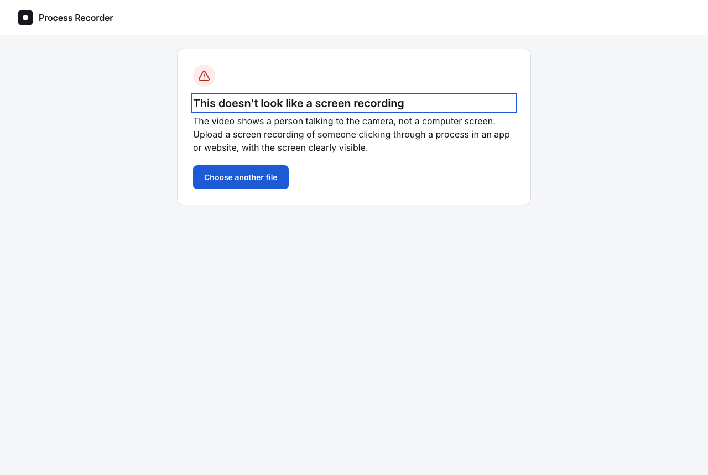

### 14. No steps found
Not treated as an error: the editor opens empty with "Add a step manually".
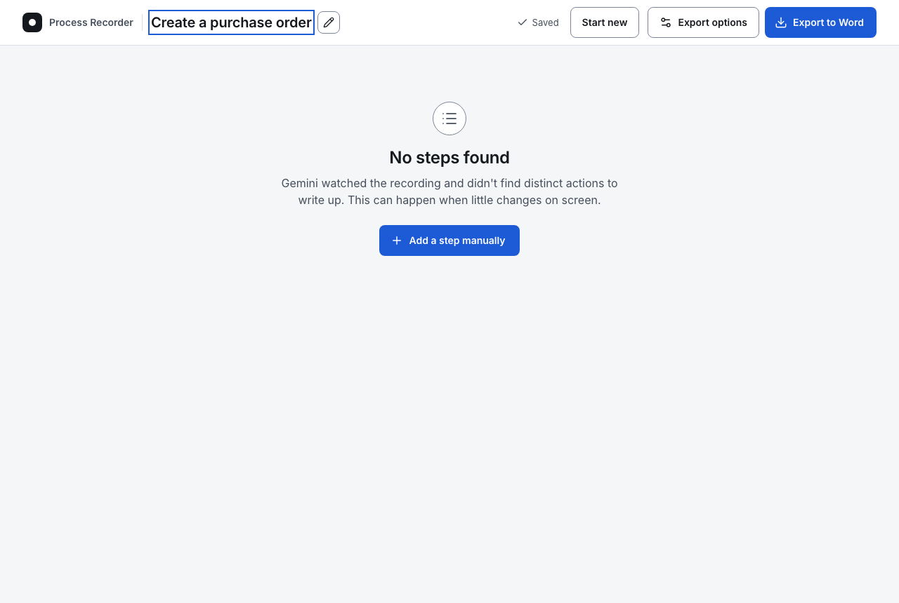

## Regenerating

Scripts are in [`scripts/screenshots/`](../scripts/screenshots/). Build first, then run against servers you start yourself:

```bash
pnpm build
GEMINI_FAKE=1 pnpm start -p 3300 &      # fake Gemini
pnpm start -p 3301 &                    # real Gemini (uses .env.local; one API call)
node scripts/screenshots/shots.mjs http://localhost:3300 "$PWD"        # all states
node scripts/screenshots/shots-real.mjs http://localhost:3301 "$PWD"   # overwrites editor states with real output
node scripts/screenshots/shot-export.mjs http://localhost:3300 "$PWD"  # export options with edits
```

**Found while capturing:** with a highlight focused, clicking another step's "Pick frame" did nothing. The highlight's keyboard hint collapsed on blur, shifting the cards mid-click. The hint now keeps its space and only fades (regression test: `e2e/regressions.spec.ts`).
